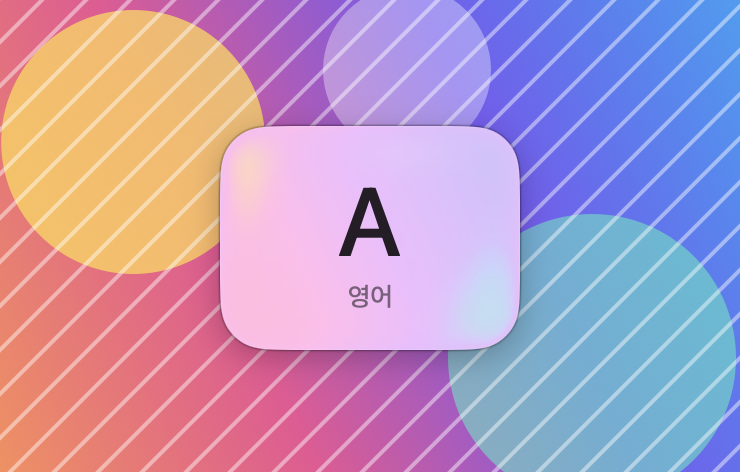
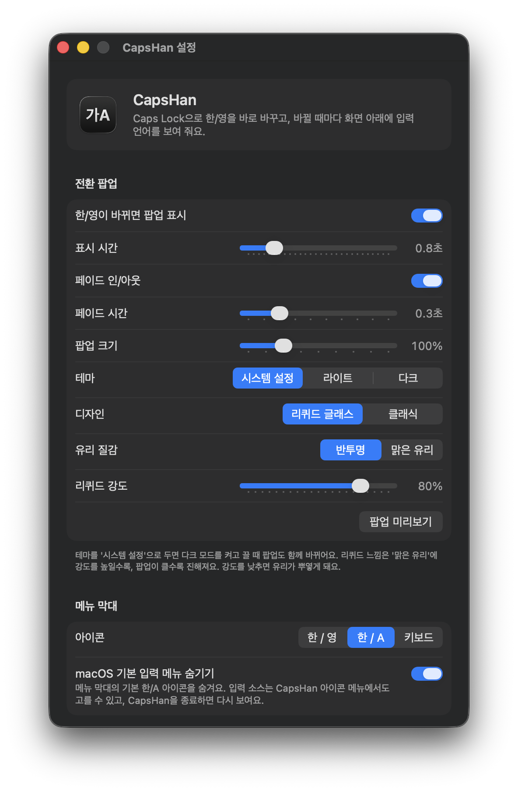
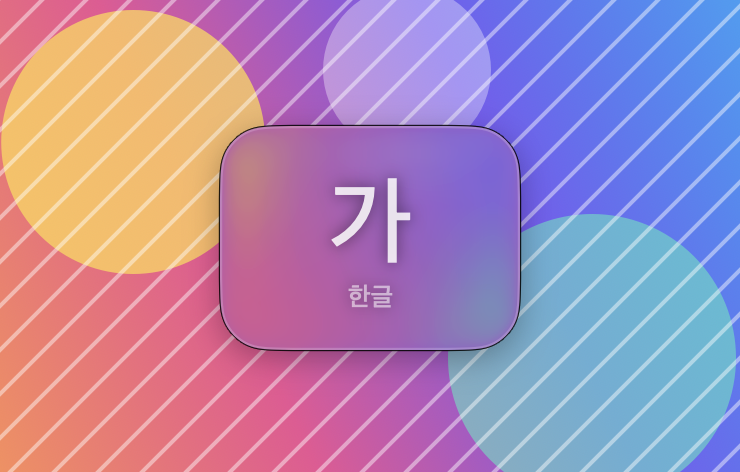
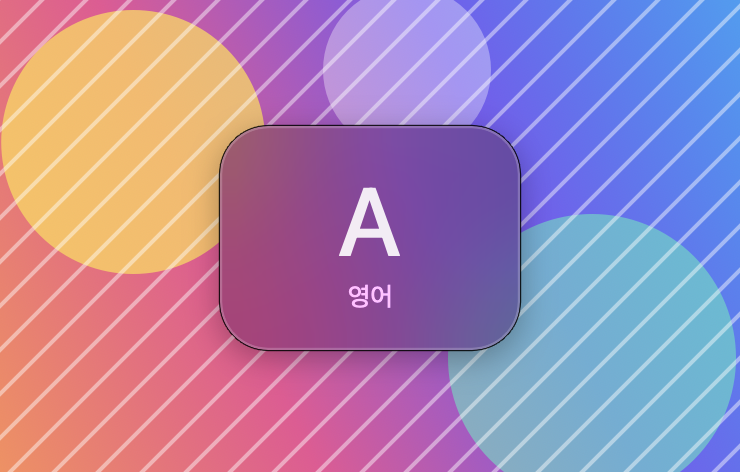

# CapsHan

맥에서 Caps Lock으로 한/영 바꿀 때 딜레이가 거슬려서 만든 메뉴 막대 앱입니다.
Caps Lock을 누르면 바로 한/영이 바뀌고, 화면 아래에 지금 입력 언어가 잠깐 표시됩니다.

<p align="center">
  
  
</p>

## 기능

- Caps Lock 한/영 전환 딜레이 제거
- 전환할 때 화면 하단 팝업 (`가 한글` / `A 영어`)
  - 리퀴드 글래스(macOS 26) / 클래식 디자인, 다크 모드 대응
  - 팝업 크기, 표시 시간, 페이드 인/아웃, 유리 투명도 조절
  - 메뉴 막대나 다른 방법으로 바꿔도 뜨고, 마우스가 있는 화면에 표시
- 메뉴 막대에 한/영 표시, 기본 입력 메뉴 숨기기
- 로그인 시 자동 실행
- Apple Silicon / Intel 유니버설, macOS 13 이상용 빌드 (macOS 26 Tahoe에서 테스트)

## 설치

[Releases](https://github.com/Moooooomin/CapsHan/releases)에서 DMG를 받아서 CapsHan을 응용 프로그램 폴더로 옮기면 됩니다.

개발자 서명이 없는 빌드라 처음 실행할 때 경고가 뜨는데, 시스템 설정 > 개인정보 보호 및 보안에서 '그래도 열기'를 누르면 됩니다. 응용 프로그램 폴더에서 한 번 실행하면 다음부터는 로그인할 때 자동으로 켜집니다.

macOS의 'Caps Lock 키로 ABC 입력 소스 전환' 옵션은 더 이상 쓰이지 않으니 꺼 두셔도 됩니다.

## 설정

앱 서랍이나 응용 프로그램 폴더에서 CapsHan을 누르면 설정창이 열립니다. 메뉴 막대 아이콘 > 설정…으로도 열 수 있습니다.

<p align="center">
  
</p>

팝업 디자인은 리퀴드 글래스와 클래식 중에 고를 수 있고, 리퀴드 글래스는 유리 질감을 바꿀 수 있습니다.

| 리퀴드 글래스 (맑은 유리) | 클래식 |
| --- | --- |
|  |  |

| 항목 | 설명 |
| --- | --- |
| 팝업 표시 | 한/영 전환 팝업 켜기/끄기 |
| 표시 시간 | 0.3~3.0초 |
| 페이드 인/아웃 | 켜기/끄기, 페이드 시간 0.1~1.0초 |
| 팝업 크기 | 80~160% |
| 테마 | 시스템 설정 / 라이트 / 다크 |
| 디자인 | 리퀴드 글래스 / 클래식 |
| 유리 질감 | 반투명 / 맑은 유리 (리퀴드 글래스일 때) |
| 리퀴드 강도 | 낮출수록 유리가 뿌옇게 됨 (리퀴드 글래스일 때) |
| 메뉴 막대 아이콘 | 한/영, 한/A, 키보드 |
| 기본 입력 메뉴 숨기기 | macOS 기본 입력 아이콘 숨김. CapsHan을 종료하면 다시 보임 |
| Caps Lock으로 한/영 전환 | 끄면 Caps Lock이 원래대로 돌아옴 |
| 로그인 시 자동 실행 | 로그인 항목 등록/해제 |

기본 입력 메뉴를 숨겨도 CapsHan 메뉴 막대 아이콘에서 입력 소스를 고를 수 있습니다.

## 동작 방식

- Caps Lock을 F18로 리매핑하고, F18을 '이전 입력 소스 선택' 단축키로 지정합니다. macOS가 Caps Lock에 두는 판단 딜레이를 거치지 않아서 바로 바뀝니다. 대신 대문자 고정은 안 되니 대문자는 Shift로 쳐야 합니다.
- 키 리매핑은 재시동하면 풀려서 앱이 켜질 때마다 다시 적용합니다. 다른 키 리매핑은 건드리지 않습니다.
- 단축키를 다시 로그인하지 않고 바로 적용하려고 비공개 API(`CGSSetSymbolicHotKeyValue`)를 씁니다. 그래서 App Store에는 못 올리고, macOS 업데이트에 따라 동작이 바뀔 수 있습니다. 그래도 단축키 설정 자체는 저장되니 다시 로그인하면 적용됩니다.
- 입력 소스가 바뀌었다는 시스템 알림을 받아서 팝업과 메뉴 막대 아이콘을 갱신합니다.

## 개인정보

네트워크를 쓰지 않고, 데이터도 수집하지 않습니다. 설정은 `~/Library/Preferences/io.github.moooooomin.capshan.plist`에만 저장됩니다. 손쉬운 사용이나 입력 모니터링 같은 권한도 필요 없습니다.

## 제거

1. 설정창에서 'Caps Lock으로 한/영 전환'과 '기본 입력 메뉴 숨기기'를 끕니다.
2. CapsHan을 종료하고 응용 프로그램 폴더에서 지웁니다.

1번을 건너뛰고 지웠다면 직접 되돌리면 됩니다.
- 단축키: 시스템 설정 > 키보드 > 키보드 단축키 > 입력 소스
- 기본 입력 메뉴: 시스템 설정 > 키보드 > 텍스트 입력 > 입력 소스 '편집…' > '메뉴 막대에서 입력 메뉴 보기'
- Caps Lock: 재시동하면 원래대로 돌아옵니다.

## 빌드

Xcode 없이 Command Line Tools만 있으면 됩니다.

```bash
./build.sh
```

`build/CapsHan.app`과 `dist/CapsHan-<버전>.dmg`가 만들어집니다. 환경 변수로 값을 바꿀 수 있습니다.

| 변수 | 기본값 | 설명 |
| --- | --- | --- |
| `BUNDLE_ID` | `io.github.moooooomin.capshan` | 포크해서 따로 배포한다면 바꿔야 합니다 |
| `VERSION` | `1.4.0` | 표시 버전 |
| `BUILD_NUMBER` | `5` | 빌드 번호 |
| `SIGN_IDENTITY` | 없음 (ad-hoc 서명) | `Developer ID Application: …` 인증서 이름 |

Developer ID로 서명하고 공증하면 경고 없이 열립니다 (Apple Developer Program 필요).

```bash
SIGN_IDENTITY="Developer ID Application: 이름 (TEAMID)" ./build.sh
xcrun notarytool submit dist/CapsHan-<버전>.dmg --keychain-profile <프로필> --wait
xcrun stapler staple dist/CapsHan-<버전>.dmg
```

## 파일 구성

```
Sources/
  main.swift            앱 시작, 메뉴 막대, 입력 소스 변경 감지
  Settings.swift        설정 값
  SettingsWindow.swift  설정창 (SwiftUI)
  HUD.swift             하단 팝업
  MenuBar.swift         메뉴 막대 아이콘, 기본 입력 메뉴 숨기기
  InputSource.swift     입력 소스 정보
  CapsLockSwitch.swift  Caps Lock 리매핑, 단축키 변경
  LoginItem.swift       로그인 시 자동 실행
Resources/Info.plist    번들 정보
scripts/make-icon.swift 앱 아이콘 생성
docs/images/            스크린샷
build.sh                빌드, 서명, DMG
```

## 라이선스

[MIT](LICENSE)
